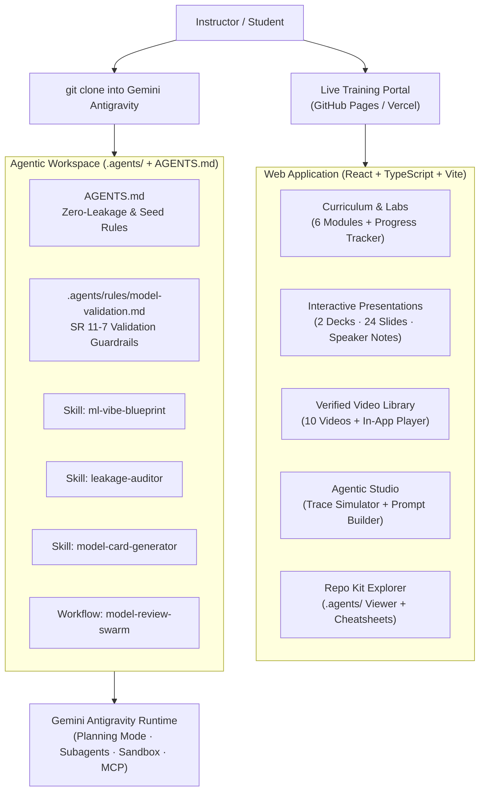
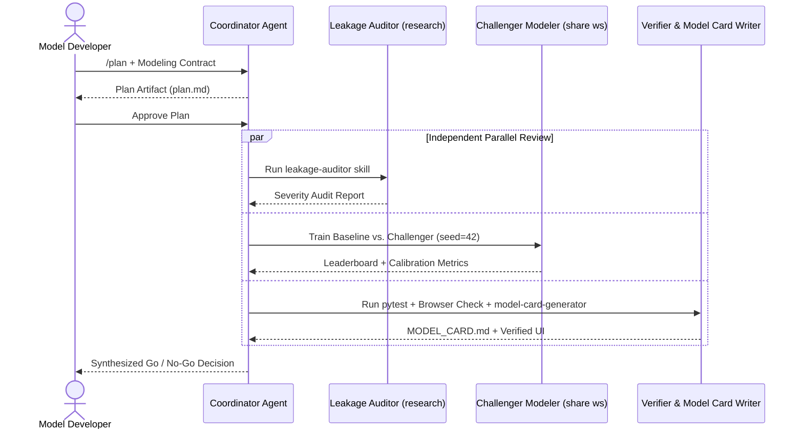
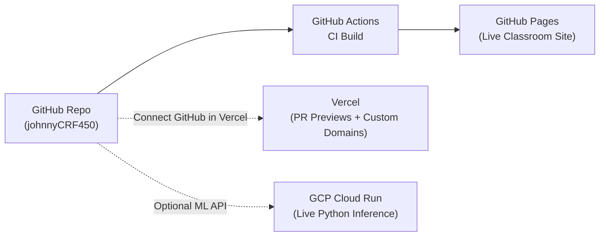

# Antigravity Model Dev Academy

**Vibe Fast. Verify Rigorously.** — An interactive training application, classroom presentation suite, curated video library, and clone-ready **Gemini Antigravity** agentic workspace built for teaching **Vibe Coding in Model Development**.

- **Live Hosted Training Portal:** https://johnnycrf450.github.io/antigravity-model-dev-academy/
- **Architecture Deep Dive:** [docs/ARCHITECTURE.md](./docs/ARCHITECTURE.md)
- **Standalone Slide Decks (Marp Markdown):**
  - [Deck 01: From Vibe Coding to Agentic Model Development](./presentations/01-vibe-coding-model-dev.md)
  - [Deck 02: Designing Agentic Architectures for ML Teams](./presentations/02-agentic-architectures-ml.md)

---

## What's Included

| Component | Description |
| :--- | :--- |
| **6-Module Training Curriculum** | Progressive syllabus covering Software 3.0, Antigravity surfaces (IDE / 2.0 / CLI), Spec-First ML prompting, `AGENTS.md` + `SKILL.md` customization, Multi-Agent Review Swarms, MCP integrations, and Deployment. |
| **2 Interactive Presentations (24 Slides)** | Built-in classroom presenter with keyboard navigation (`←`/`→`), fullscreen mode, toggleable **Instructor Speaker Notes**, and Print-to-PDF export (plus standalone Markdown decks in `presentations/`). |
| **10 Verified Curated Videos** | Real, verified YouTube tutorials & keynotes (Andrej Karpathy, Y Combinator, codebasics, Google Antigravity, MCP & Subagents guides) playable in-app with classroom discussion prompts. |
| **Interactive Agentic Studio** | Live multi-agent workflow simulator across 4 ML scenarios (Credit Risk, Churn, Forecasting, Fraud) with toggleable governance guardrails and a tailored Antigravity Prompt Builder. |
| **Clone-Ready `.agents/` Starter Kit** | Working `AGENTS.md`, validation rules, 3 progressive-disclosure `SKILL.md` runbooks (`ml-vibe-blueprint`, `leakage-auditor`, `model-card-generator`), and a 4-agent review swarm playbook. |

---

## System & Pedagogical Architecture



---

## Multi-Agent Model Validation Flow



---

## 6-Module Course Syllabus

| Module | Topic | Duration | Hands-On Lab | Slides |
| :--- | :--- | :--- | :--- | :--- |
| **MOD-01** | Software 3.0 & The Vibe Coding Shift | 45 min | Lab 1: Vibe vs. Verify — Spot Hidden Leakage | Deck 1 (1–5) |
| **MOD-02** | Mastering Gemini Antigravity Surfaces | 60 min | Lab 2: Multi-Modality Feature Pipeline Tour | Deck 1 (6–9) |
| **MOD-03** | Spec-First Vibe Coding for Model Dev | 60 min | Lab 3: Baseline-to-Challenger Leaderboard | Deck 1 (10–12) |
| **MOD-04** | Customizing Antigravity (`AGENTS.md` & Skills) | 60 min | Lab 4: Author a Custom `bias-slice-checker` Skill | Deck 2 (1–6) |
| **MOD-05** | Multi-Agent Orchestration & MCP | 75 min | Lab 5: Run the 3-Agent Model Validation Swarm | Deck 2 (7–10) |
| **MOD-06** | Verification, Deployment & Capstone | 75 min | Lab 6: Ship an Interactive Model Explorer App | Deck 2 (11–12) |

---

## Curated & Verified Video Library

| Video | Creator | Focus | Module |
| :--- | :--- | :--- | :---: |
| [Andrej Karpathy: Software Is Changing (Again)](https://www.youtube.com/watch?v=LCEmiRjPEtQ) | Y Combinator | Software 3.0 & Vibe Coding | MOD-01 |
| [Vibe Coding Is The Future](https://www.youtube.com/watch?v=IACHfKmZMr8) | Y Combinator | Conversational Agent Workflows | MOD-01 |
| [Google Antigravity 2.0 Tutorial for Beginners](https://www.youtube.com/watch?v=EB4-udhgVaY) | James NoCode | Antigravity 2.0 Workspace Tour | MOD-02 |
| [Google Antigravity Tutorial for Beginners](https://www.youtube.com/watch?v=1Q5sWISByuw) | codebasics | End-to-End Beginner Walkthrough | MOD-02 |
| [Google Antigravity Explained for Normal People](https://www.youtube.com/watch?v=oBaT-wo9RTY) | Paul J Lipsky | Accessible Setup & Live Build | MOD-02 |
| [Google Antigravity Full Tutorial for Beginners](https://www.youtube.com/watch?v=EtuWP9Ugo34) | Mikey Vibe Coding | Agent Manager & Self-Healing Loops | MOD-03 |
| [Customizations in Google Antigravity 2026](https://www.youtube.com/watch?v=zCrIr_75n1o) | ProgrammingKnowledge2 | Rules, Skills, Subagents & MCP | MOD-04 |
| [How to Configure MCP Tools in Antigravity IDE](https://www.youtube.com/watch?v=zdvmBgpvRbI) | ProgrammingKnowledge2 | MCP Servers & External Tools | MOD-05 |
| [How to Use Antigravity Subagents Like a Pro](https://www.youtube.com/watch?v=KsK2KykRJho) | The Next Signal | Parallel Multi-Agent Orchestration | MOD-05 |
| [Google Antigravity IDE 2026 Masterclass](https://www.youtube.com/watch?v=x97dQYtY468) | ProgrammingKnowledge2 | End-to-End Agentic Engineering | MOD-06 |

Official channels & docs:
- [Google Antigravity YouTube (`@googleantigravity`)](https://www.youtube.com/@googleantigravity)
- [Google Antigravity Docs](https://antigravity.google/docs)

---

## Repository Structure

```text
antigravity-model-dev-academy/
├── AGENTS.md                                  # Root workspace model governance rules
├── .agents/
│   ├── rules/model-validation.md              # SR 11-7 style validation guardrails
│   ├── skills/
│   │   ├── ml-vibe-blueprint/SKILL.md         # 5-phase modeling blueprint skill
│   │   ├── leakage-auditor/SKILL.md           # 5-vector leakage audit skill
│   │   └── model-card-generator/SKILL.md      # Stakeholder Model Card generator skill
│   └── workflows/model-review-swarm.md        # 4-agent parallel validation playbook
├── docs/
│   ├── ARCHITECTURE.md                        # Detailed agentic architecture & diagrams
│   └── github-pages-workflow.example.yml      # Optional GitHub Actions workflow template
├── presentations/
│   ├── 01-vibe-coding-model-dev.md            # Standalone Deck 1 (Marp Markdown)
│   └── 02-agentic-architectures-ml.md         # Standalone Deck 2 (Marp Markdown)
├── src/                                       # React + TypeScript + Tailwind training portal
│   ├── components/                            # Views (Home, Curriculum, Presentations, Videos, Studio, Repo Kit)
│   └── data/                                  # Course curriculum, 24 slides, verified videos, simulator engine
├── vercel.json                                # Zero-config Vercel deployment descriptor
└── vite.config.ts                             # Relative base config for GitHub Pages + Vercel parity
```

---

## Quickstart (Local Development)

```bash
git clone https://github.com/johnnyCRF450/antigravity-model-dev-academy.git
cd antigravity-model-dev-academy
npm install
npm run dev
```

Open the local URL printed by Vite, or open the folder directly in **Gemini Antigravity** to activate `AGENTS.md` and all three `.agents/skills/` automatically!

---

## Deployment & Hosting

### 1. GitHub Pages (Live Now!)
The built production bundle is published to the `gh-pages` branch and hosted live at:
`https://johnnycrf450.github.io/antigravity-model-dev-academy/`

To enable automatic rebuilds on every push to `main`, copy [`docs/github-pages-workflow.example.yml`](./docs/github-pages-workflow.example.yml) to `.github/workflows/deploy.yml` (requires the GitHub `workflow` OAuth scope or adding the file via the GitHub web UI).

### 2. Vercel (Optional Instant Preview & Production Hosting)
`vercel.json` is pre-configured. To enable automatic Vercel deployments on every PR/push:
1. Open [vercel.com/new](https://vercel.com/new) and connect your GitHub account (`johnnyCRF450`).
2. Import `johnnyCRF450/antigravity-model-dev-academy` and click **Deploy**.

### 3. Google Cloud Platform (Optional Python Model Backend)
For student capstones that require live Python inference (FastAPI / Streamlit / BigQuery), deploy the backend service to **Google Cloud Run** (`gcloud run deploy`) and point the static React frontend to its HTTPS endpoint.


