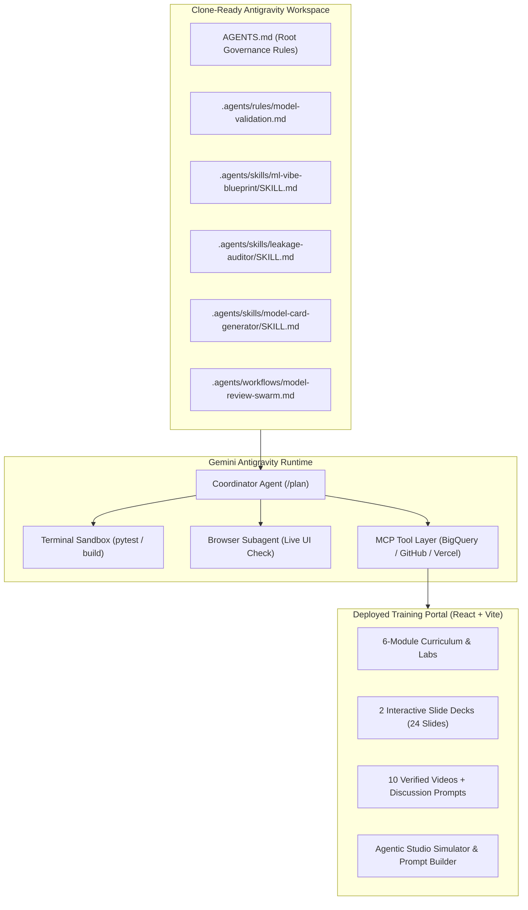
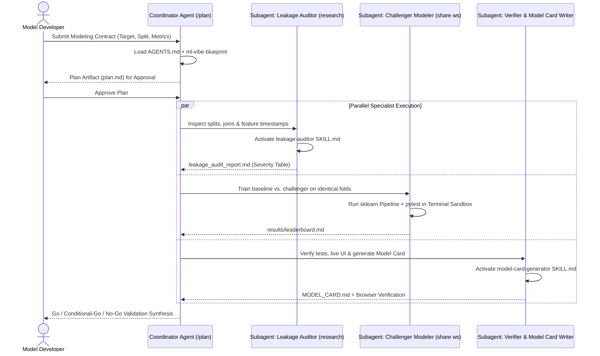
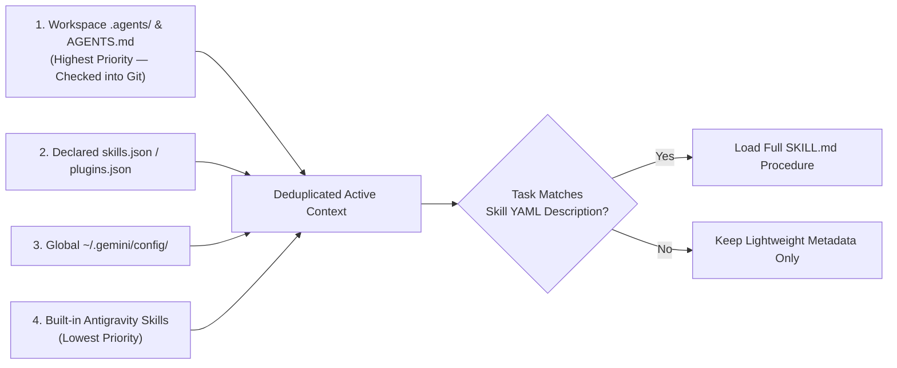
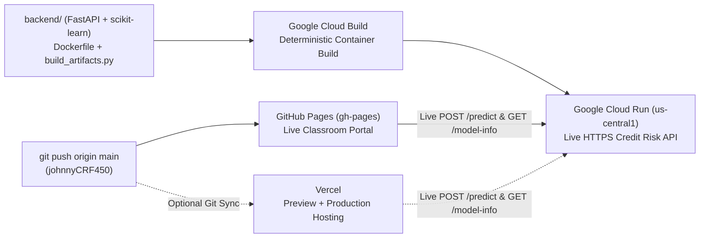

# Agentic Architecture Specification

This document details the agentic architecture implemented inside **Antigravity Model Dev Academy**—both as a **live educational web portal** and as a **clone-ready Gemini Antigravity workspace**.

---

## 1. Dual-Layer System Architecture

The repository serves two complementary roles:
1. **Interactive Classroom Web App (`src/`)**: Deployed via GitHub Pages (and Vercel-ready) so students can browse the 6-module curriculum, follow 2 interactive slide decks, watch 10 verified videos in-app, and simulate multi-agent ML workflows in the **Agentic Studio**.
2. **Executable Antigravity Workspace (`AGENTS.md` + `.agents/`)**: When students clone the repo into **Gemini Antigravity IDE**, **Antigravity 2.0**, or **`agy` CLI**, the workspace automatically loads model governance rules and progressive-disclosure ML skills.

---

## 2. Multi-Agent Model Validation Swarm

To mirror institutional **Model Risk Management (SR 11-7)** and eliminate single-agent confirmation bias, the workspace includes a 4-agent parallel review workflow (`.agents/workflows/model-review-swarm.md`):

---

## 3. Customization Discovery & Progressive Disclosure

Antigravity avoids saturating the LLM context window by injecting only skill names and concise descriptions at startup, loading the complete `SKILL.md` only when relevant:

---

## 4. Workspace Isolation Matrix

| Agent Role | Subagent Type | Workspace Mode | Rationale |
| :--- | :--- | :--- | :--- |
| Coordinator | Main Session | `inherit` | Owns user contract, plan approval, and final synthesis |
| Data & Leakage Auditor | `research` | `inherit` | Read-only inspection; cannot accidentally modify training scripts |
| Challenger Modeler | `self` | `share` | Shared-repo worktree allows concurrent training/testing without file collisions |
| UI & Test Verifier | `self` + `browser` | `inherit` | Runs production build and validates live localhost/deployed views |

---

## 5. CI/CD Deployment Pipeline & Live GCP Cloud Run Architecture

